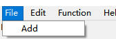
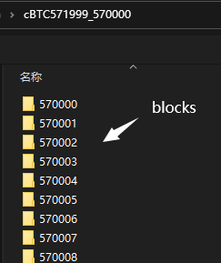
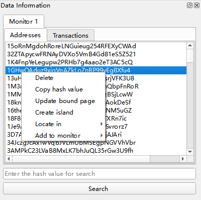
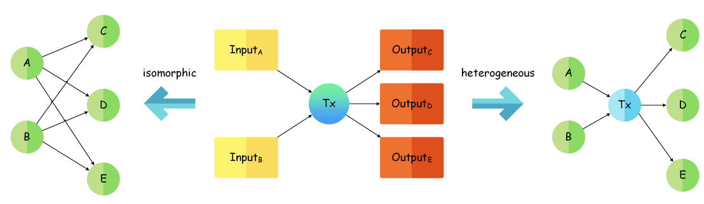
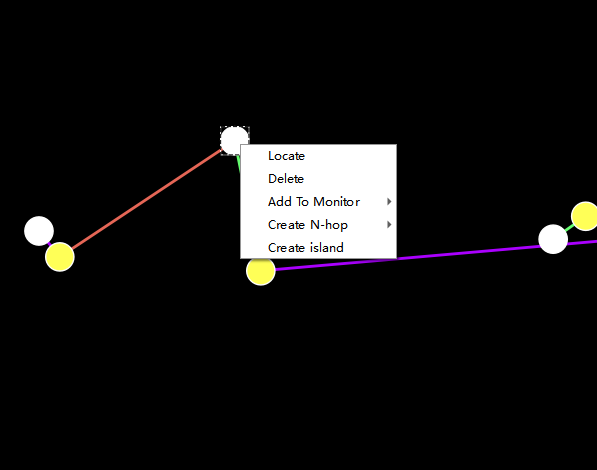
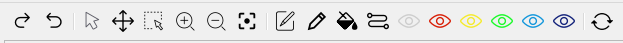
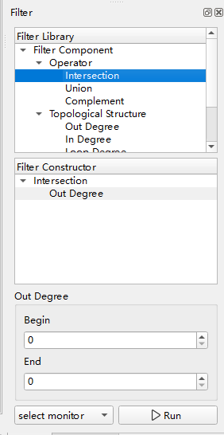

# BTCShadow
BTC Shadow is a highly interactive tool for analyzing and exploring bitcoin data in graph form. Currently, the functions of BTC Shadow is not completed and in the future we wil update. 

We provide an executable version and an example dataset to try BTC shadow. The tool and examples can be obtained in <a>https://1drv.ms/u/c/19b6c656b7a9df26/ESbfqbdWxrYggBkABAAAAAABLzZ1xPFEFnwMZy9_LpI5sg?e=7jmS0n  and https://1drv.ms/u/c/19b6c656b7a9df26/ESbfqbdWxrYggBn9AwAAAAABcddeSr-KEhqyQC1mJh49qQ

## Loading data
BTC Shadow supports only one type of Bitcoin data now, which is obtained by crawling the [website] in JSON format. You can click File - Add and then choose a folder that contains block folders. They look like the ones below.



And after choosing the number of blocks loaded, the data will be stored in the monitor.


## Monitor
The monitor will be created when loading the data or other operations that generates data. It's a list view that shows addresses and hash value of transactions.



In this module, you can:
+ Delete addresses. If all addresses in one transaction are deleted, the transaction will also be deleted.
+ Copy the hash value of the selected address.
+ Update bound graph page (<font color="#dd0000" size=2>Warning: The layout of the graph must be generated manually. It can't generate automatically.</font>).
+ Create an island. Generate the biggest connected graph of the selected address.
+ Locate in. Find where the selected address is on any graph page.
+ Add to monitor. Add the selected address to another monitor.

## Graph page
When calling ___Update bound page___ function of the monitor, it will create a corresponding graph page in the center. Each monitor corresponds to each graph page. The bound graph page will be removed if the corresponding monitor is removed.



The graph page aims to show the graph of Bitcoin data in isomorphic or heterogeneous form. 

In an isomorphic graph, the white node represents the account and the cyan line represents the flow of bitcoins. 

In a heterogeneous graph, the white node represents the account, the yellow node represents the transaction, the green line represents the flow of bitcoins from transaction to account, the red line represents the flow of bitcoins from account to transaction and the purple line represents the bidirectional.



In this module, you can:
+ Scroll the wheel of the mouse to zoom view.
+ Click with the left mouse key and drag the mouse to drag the view
+ Click with the left mouse key on a node to select a node.
+ Locate the selected node.
+ Delete a selected node.
+ Add selected node to monitor. 
+ Create an N-hop graph of the selected node.
+ Create island(the biggest connected graph) of selected node.

## Toolbar for graph
The toolbar contains a set of tools for graph pages, which can move the view or change the color of an item in a graph to illustrate analytical results. Each button from the left denotes:



+ Redo the operation that edits the graph 
+ Undo the operation that edits the graph
+ Click mode
+ Drag mode
+ Multi-selection mode
+ Zoom in
+ Zoom out
+ Back to graph center
+ Edit the label of one selected node.
+ Edit the color of one node. Choose a color first and then click one node to change the color of it.
+ Edit the color of nodes by rules. There are three rules:
    + Connection. When using this rule, the nodes around the clicked node will be colored by circle and circle according to the number of clicks.
    + UTXO. This is similar to Connection, but the nodes of neighbor circles must have the relationship of UTXO.
    + Label. Edit color of all nodes that have same the label.
+ Find the path between two nodes and color it.
+ Transform to heat map by rules that can be customized. 
+ Reset the graph.

## Attributes and context display
These two modules display attributes of selected nodes and information of monitor in text form. The information displayed can be customized. Specifically, you can edit the .ini files in the Customization folder. The content looks like this:

```ini
[Attribute Name]
# Your Python code here
# You can use the variable "item" which is the item selected in the graph and its structure is in the structure folder
# You must define the value, which is shown in BTCShadow finally
value = *****

[Example]
# Here is an example that returns the type of item
value = "Account" if isinstance(item, AccountPoint) else "Transaction"
```
And you follow these to define your attribute:
1. Define the name of the attribute
2. Write Python code with variables offered.
3. Define the variable "value" to end


## Related object
This module will show the items related to the selected item in the graph. It's in recursive tree form, which means every item in this module will also have a subtree. The depth of the root tree depends on the settings. You can click the right button in this module to call ___Reset in depth___, which can set the depth of the root tree.


If you click an input item or an output item with the right button, you can call ___Trace/Follow the UTXO(5)___ where ___5___ means the depth of trace or follow. And the result is that the road that utxo passed will be colored red.

## Filter
This module is for filtering out the accounts that you don't want. It consists of three parts: filter library, filter constructor, and filter parameter.



You can follow these operations:

1. Drag the filter component from the filter library to the filter constructor. A filter component can be the child or sibling of one filter component.

2. Set the parameter of the filter component in the filter constructor.

3. Select a monitor for the final filter that your constructor and click the Run button.

Then you will get a new monitor after filtering. The customization of filters is similar to attribute and the details can be found in .ini files.

## Distribution
This module offers to conduct an analysis, which is shown in a chart.


[website]: https://btc.com/api-doc
